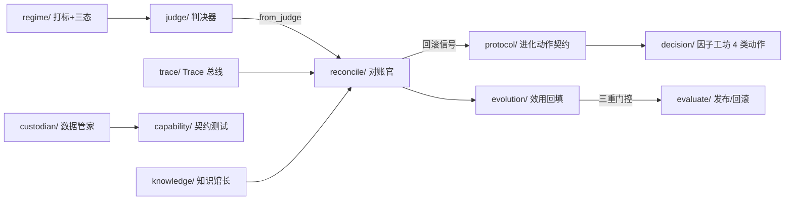

# 确定性层全景（P0–P4 已实现代码）

> 按「**先写确定性代码，再包 agent**」的原则，本仓已把 P0–P4 各阶段的确定性核心落成
> **12 个 Python 包 + 1 份评测集 DDL**，118 个新单测全绿（全套 173 用例）。本页是它们的索引——
> 每个包对应哪个阶段 / Agent / 设计文档、测了多少、还剩什么。
> 详细契约与验收判据见 [P0 落地规格](/p0-spec.html)。

## 全景表

| 阶段 | 包 / 文件 | 对应 Agent / 纵贯线 | 设计文档出处 | 测试数 |
| --- | --- | --- | --- | --- |
| P0 | `judge/` | 回测判决官（冻结层，既有） | 现状报告 §3 / caliber-contract | 55 |
| P0 | `trace/` | Trace 总线（可观测纵贯线） | observability.md | 15 |
| P0 | `reconcile/` | 对账官（结果归因·信用传播） | self-evolution §4 · observability §5 | 17 |
| P0 | `regime/` | regime 验证 + 打标 + 跑数（任务 16） | eval-dataset 6.2 | 25 |
| P0 | `scripts/eval_dataset_v1.sql` | 评测集 7 表落库 | eval-dataset §6.3 | — |
| P1 | `custodian/` | 数据管家（agent 壳契约层） | agent-prompts #10 | 6 |
| P1 | `capability/` | 能力管家（契约测试 + 注册表） | agent-prompts #12 | 6 |
| P1 | `protocol/` | 协议注册表（治理工件） | protocol.md | 10 |
| P1 | `knowledge/` | 知识馆长（知识卡 + 证据分级） | agent-prompts #11 | 7 |
| P2 | `decision/` | 决策面 6 契约（主控/调度器/策略师/因子工坊/大盘/哨兵） | agent-prompts #1–6 | 14 |
| P3 | `evaluate/` | 评测平台（评估器 + 三重门控） | evaluator.md · self-evolution §5 | 8 |
| P4 | `evolution/` | 自进化（三元组 + 效用检索） | self-evolution §1/§3 | 5 |
| 横切 | `agent/` | 13 Agent 机器可读 roster（与 ACL 交叉校验） | agent-roster.md | 5 |

## 确定性层如何串起来

## 还剩什么（非确定性层）

- **LLM agent 壳**：13 个 agent 的确定性核心已立，但运行时壳（tool 注册、prompt 加载、调度接线）未包——这是「再包 agent」阶段。
- **任务 16 剩余 9 项**：已实证 6/15（涨停家数/beta/宽度/换手率/拥挤度/大盘闸门，见 eval-dataset 6.2.3）；剩余 9 项（消息面需 LLM、情绪指数/市场周期/C/r²/资金风格/多空 需较大新增计算、优先级/覆盖率为元规则）。
- **旧报告按净口径重跑**：10/15 份报告是旧 schema（缺 net/cost 字段），需在最终代码上重跑。
- **评测集 DDL** 尚未在评测库实跑建表；`verdict`/`paired_control` 回填未接。
