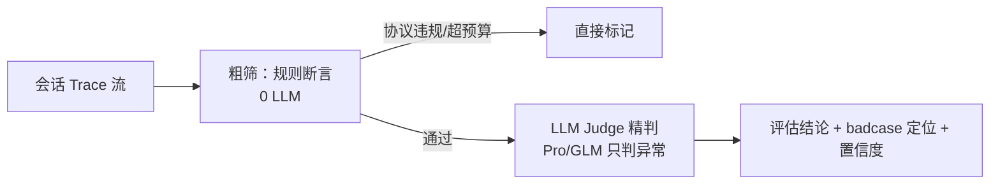

# 评估器设计（过程评估）

> **初稿** · 评估器是「过程进化」的评判引擎，由**会话评估官**持有。本页定它「在系统中的位置」与「功能」，会话业务相关的评估器清单是初版，后面随具体业务持续打磨。

## 一、评估器在系统中的位置

评估器不是独立 Agent，而是**会话评估官**手里的机制——用来判断「推理质量 / 工具效率 / 协议合规 / 成本」这些**开放语义**好不好。

它在系统里卡在三个交接点上：

| 交接点 | 上游（喂什么） | 下游（出什么） |
| --- | --- | --- |
| 可观测 → 评估 | 会话评估官读 trace（四元 id + 三层语义） | 评估结论：badcase 定位 + 置信度 |
| 评估 → 进化 | 评估结论（badcase 率按节点统计） | 过程归因 → 改 prompt/skill/协议 |
| 评估 → 门禁 | 评估结果 + 证据 | 三重门控（增益/遗忘/安全）→ 发布/回滚 |

**与「信用传播」的分水岭**：结果归因（因子/策略，可验证）用信用传播；过程评估（开放语义）用评估器。分水岭的完整解释见 [评测与可观测](/eval-platform.html)。

## 二、评估器是什么：三要素

一个评估器 = 给「某类过程问题」定义一套**可复核的判断标准**：

| 要素 | 含义 | 为什么只给这么多 |
| --- | --- | --- |
| **证据** | 只取必要 span（某次推理的输入/输出、某次工具调用的入参/返回），不看整条 trace | 准确（减少无关材料干扰）、省钱（token 更少）、更快 |
| **边界** | 什么算 bad、什么算 good、什么算「待复核」 | 边界不清 = 评估器自己来回翻 |
| **判定** | 粗筛规则（0 LLM）+ LLM Judge 精判（Pro/GLM） | 能规则的用规则，不能的才上 LLM |

> **判定方法也遵循「能规则就用规则」**：协议合规、成本预算这类可机器验证的，用规则断言；推理质量、工具效率这类开放语义，才用 LLM Judge。这是「因子用公式、过程用评估器」的分水岭在**评估器内部更细一层**上的同样应用。

## 三、评估粒度：结果 / 节点 / 轨迹

评估目标决定取数范围，会话过程可在三层粒度上评估，多轮可跨层核对：

| 粒度 | 看什么 | 能检查什么 |
| --- | --- | --- |
| **结果** | 最终回答 / 决策包 | 是否完成目标、结论是否有依据 |
| **节点** | 指定 span 的入参与返回值（某次工具调用、某次模型调用） | 查询参数对不对、工具返回对不对、节点是否满足约束 |
| **轨迹** | 相关 span 与步骤关系 | 必查项覆盖、步骤关系、过程约束是否保留 |

> 局部通过 ≠ 任务完成；证据不足需复核，不默认通过。

## 四、股票场景的评估器清单（初稿）

会话评估官针对**四类过程问题**各定义一个评估器。此清单是初版，随具体会话业务打磨。

### 4.1 推理质量评估器

- **证据**：主控意图理解 span（用户意图 → 规划）+ 策略师推理 span（假设 → 结论）
- **边界**：bad = 遗漏任务约束、答非所问、张冠李戴（把 A 股当 B 股、把「近 3 日」当「昨日」）；good = 完整覆盖约束、结论有依据
- **判定**：LLM Judge（Pro），低置信升级复核
- **示例**：主控理解「诊断账户近 3 日表现」，策略师却只查「昨日」→ bad

### 4.2 工具效率评估器

- **证据**：工具调用 span（入参 / 返回）+ 数据取数 span（口径字段）
- **边界**：bad = 重复调用、用错工具、遗漏必要取数、口径错配；good = 调用符合契约、取数完整
- **判定**：规则粗筛（0 LLM）+ LLM Judge 精判
- **示例**：数据管家取「涨停家数」却用了错误的板块口径 → bad

### 4.3 协议合规评估器

- **证据**：消息信封 span（四元 id / 类型 / schema 版本 / 幂等键）+ 写域操作
- **边界**：bad = 越权写生产、消息格式不合规、缺幂等键；good = 协议执行正确
- **判定**：规则（机械断言，0 LLM，协议总线进总线即校验）
- **示例**：主控越权写判决库 → bad（ACL 拦截，进不了判决器）

### 4.4 成本预算评估器

- **证据**：token / 时延 / 调用量 span
- **边界**：bad = 超出预算（P95 时延超上限、单次成本超预算）；good = 在预算内
- **判定**：规则（0 LLM）
- **示例**：一次复盘 Pro 调用超预算 → bad

## 五、多阶段降本：粗筛规则 + LLM Judge 精判

过程评估不必每条都喂 Pro——先粗筛，只有「异常」才精判：



| 阶段 | 手段 | 成本 | 处理量 |
| --- | --- | --- | --- |
| 粗筛 | 协议合规、成本预算、口径校验（规则） | 0 LLM | 全量 |
| 精判 | 推理质量、工具效率（LLM Judge） | 少量 | 仅粗筛通过 + 需要语义判断的 |

> 这是「多阶段降本」的**过程侧**；**结果侧**（规则 → 统计 → LLM 复盘）见 [可观测平台设计](/observability.html) 的多阶段评估。

## 六、评估器开发流程（Skill + CLI）

一个评估器从定义到上线，走五步闭环，正确率不达标不上线：

```
① 定义评估器（证据 / 边界 / 判定步骤）
→ ② 准备数据集（标注好的 good/bad 样本）
→ ③ 批量评测（在数据集上跑，算 badcase 正确率）
→ 达到上线门槛？
   是 → ⑤ 上线（接入流水线，进 badcase 看板）
   否 → ④ 错例分析与修正（调边界 / 证据 / 判定步骤）→ 回到 ③
```

- **评估器开发 Skill**：把「定义 / 评测 / 错例修正」的方法沉淀下来，交给会话评估官执行。
- **配套 CLI**：命令行完成数据集评测 / 错例查看 / 上线发布，便于反复迭代。

## 七、有效性验证三件套

评估器上线前必须过三关，否则「改 prompt」没有可靠依据：

1. **对照人工标注**：正例 / 反例 / 边界样本，按同一标准逐条比对。
2. **看误判漏判**：符合要求却判失败 = 误判；不满足却判通过 = 漏判。
3. **预留样本验证**：校准后验证未参与调整的样本。

## 八、数据集建设：三集分离

过程评测集的样本资产（基准集/回归集/校准集 + 单 case 结构 / 分布 / 构建 / GT / 隔离 / 问题集）见 [评测集设计](/eval-dataset.html)。这里只强调一句：**回归集不替代基准集，校准用独立样本**。

## 九、质量准出：三重门控

过程进化的「发布门禁」（增益/遗忘/安全）权威版在 [自进化设计](/self-evolution.html) 第 5 节。评估器只负责产出「可复核的 badcase 判定」，门禁的发布/回滚由进化层执行——评估器不越权做发布决策。

## 十、指标驱动归因 + 在线复核 + 双轨闭环（过程版）

- **指标驱动归因**：过程 badcase 率按节点（意图/规划/工具/检索/回答）统计 → 定位「哪个环节推理质量差 / 哪个工具效率低」。
- **在线复核**：筛选复核样本（低置信 + 异常），人工核对评分与证据，区分「Agent 问题 / 评估器误判 / 数据配置问题 / 证据不足」。
- **双轨闭环**：在线发现问题 → 人工复核标注 → 补入回归/校准集；离线用回归/校准集验证 prompt/skill 修改 → 门禁 → 发布。

> 这是「指标归因」的**过程侧**；**结果侧**（因子失效/出场太慢等）见 [可观测平台设计](/observability.html) 第 5 节。

## 初稿待打磨项

- [ ] 四类评估器的**边界**要随真实会话业务补正例/反例（尤其推理质量的「遗漏约束」边界最难定）。
- [ ] 评估器清单按业务扩展到「记忆遗漏、指令泄露、自我认知」等（对应 AI NEX 的典型问题表，但落到股票场景）。
- [ ] 数据集三集的**样本量 / 标注口径**要在真实会话流量上定。
- [ ] 「有效性验证三件套」的**正确率达标线**（多少算达标）待定。
- [ ] 在线复核的**抽样比例**与「Agent 问题 vs 评估器误判」的仲裁流程待细化。
