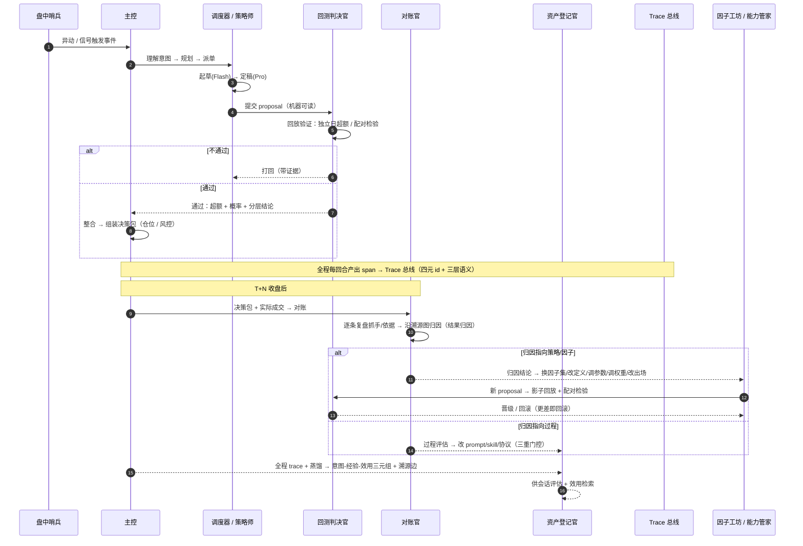

# 决策生命周期

主控规划 → 回测验证 → 对账归因 → 进化回滚。一条策略从触发到复盘、再到进化的全链路——**每一步同时活在「可观测」与「自进化」两条纵贯线上**。

## 十二步走（含进化回路）

1. 盘中哨兵捕获异动/信号 → 2. 主控理解意图、规划、派单 → 3–4. 策略师生成 proposal（Flash 起草、Pro 定稿）→ 5. proposal 交给回测判决官 → 6. 回放验证（独立日超额、配对）→ 7. 不通过则带证据打回 → 8. 通过则主控整合 → 9. 组装决策包（仓位/风控）→ 10. T+N 收盘对账，沿溯源图**归因** → 11. 归因落到策略/因子或过程，**进化**（影子回放/三重门控）→ 12. 晋级或回滚。

全程每回合产出 span → Trace 总线；蒸馏 → 意图-经验-效用三元组 → 供会话评估与效用检索。

> 关键：第 10–12 步是可观测（trace）→ 归因（溯源图·信用传播）/ 评估（评估器）→ 进化（回灌可进化层）的闭环，把「复盘」从一次性的动作变成了**持续进化的输入**。
