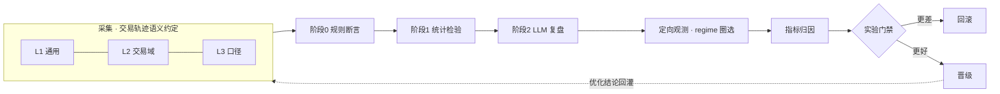
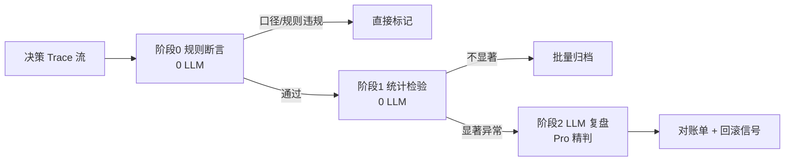
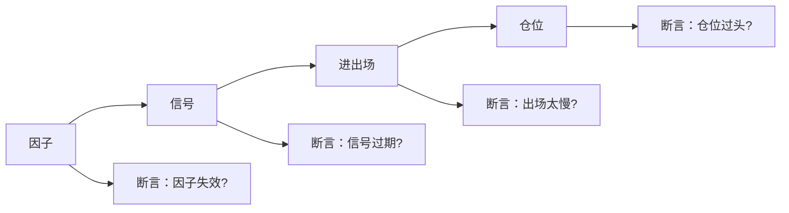

# 可观测平台设计（借鉴 AI Vision）

> 参考蚂蚁集团「AI Vision 可观测平台」分享，把 PLAN-03 里的「评测平台接入」一节**运营化**。核心骨架（裁决面 / 判决器 / Trace 总线 / 四元 id）已经同构，本页补充六条可执行机制。

## 一句话定位

判决器优先、物理隔离，再加一层**接口隔离**：用「交易轨迹语义约定 + 声明式表达式」让评估器与选手解耦，用「三阶段评估 + 定向观测」把复盘成本压到可运营，用「指标归因 + 实验门禁」让优化可自动回滚。



## 六条机制（AI Vision → 交易系统）

| AI Vision 机制 | 你的系统怎么落地 | 解决什么 |
| --- | --- | --- |
| 三层语义约定（OTel GenAI） | 交易轨迹语义约定：L1 通用 · L2 交易域 · L3 口径 + 前缀白名单门禁 | 四元 id 升级为分层语义；数据地雷机械拦截 |
| 声明式表达式（DSL） | 判决器/对账官用表达式从 trace 取值，判定侧只声明变量 | 判定侧与选手接口隔离，换 agent 不改判定侧 |
| 多阶段评估 | 规则断言 → 统计 → LLM 复盘（Pro 只精判异常） | 99% 决策零 LLM 成本，复盘聚焦 |
| 定向观测 | 给决策打 regime 标签，按切片评估 | 指标不被稀释；验证分层假设 |
| 指标驱动归因 + 实验 | 反面清单→规则断言（因子/策略）+ 信用传播；影子回放 + 配对门禁 | 结果归因自动化；更差即回滚 |
| Token 粒度 + logprobs | 会话评估官的过程评估器用 logprobs 判稳定性；决策包带概率置信度 | 过程评估器不「来回翻」；兑现概率权重 |

## 一、交易轨迹语义约定（对标 OTel GenAI 三层）

| 层 | 前缀 | 内容 | 示例 |
| --- | --- | --- | --- |
| L1 通用 | `trace.*` | 会话/回合/模型/工具调用的通用字段 | `trace.turn`, `trace.model`, `trace.tool` |
| L2 交易域 | `trad.*` | 决策/策略/因子/对账的专属语义 | `trad.decision_id`, `trad.strategy_id`, `trad.signal` |
| L3 口径 | `a股.*` | 数据口径：复权基准、单位、代码格式、涨跌停、板块 | `a股.adjust=前复权`, `a股.code=000001.SZ`, `a股.unit=元` |

::: warning 前缀白名单门禁
上报属性先过前缀校验：`trace.*` / `trad.*` / `a股.*` 通过；不符合规范前缀（如 `my_attr`）直接拒绝。这把你「未经严谨考证的数据不用于决策」变成了**机械断言**——口径缺失或代码格式不合法的 trace，在采集层就被拦下，进不了判决器。
:::

## 二、声明式表达式：判定侧与选手接口隔离

判决器/对账官**只声明需要哪些变量**，DSL 表达式负责从不同结构的 trace 取值。换一个策略/Agent，只改表达式，不动判决器代码。

```
# 对账官需要的变量（只声明，不关心 trace 结构）
signal     = spans[name=="strategy.proposal"].output.signal
entry_px   = spans[name=="execution.fill"].input.order.price
stop_px    = spans[name=="strategy.proposal"].output.risk.stop
limit_up   = spans[name=="market.bar"].input.a股.limit_up
```

价值：物理隔离防的是「代码/进程共模」，声明式表达式防的是「**接口共模**」——选手改字段名，判决器不会跟着崩。

## 三、多阶段评估：复盘不必每条都喂 Pro



| 阶段 | 手段 | 成本 | 处理量 |
| --- | --- | --- | --- |
| 阶段 0 规则断言 | 口径校验、缺失字段、涨停封死不可卖、T+1 违反 | 0 LLM | 全量 |
| 阶段 1 统计检验 | 独立日超额、剔 beta、配对 t 检验（确定性代码） | 0 LLM | 全量 |
| 阶段 2 LLM 复盘 | Pro 逐条复盘抓手/依据 | 少量 | 仅超额 >2σ / regime 突变日 / 打脸最狠的决策 |

> 这是「多阶段降本」的**结果侧**（对账复盘）；**过程侧**（评估器粗筛 + LLM Judge）见 [评估器设计](/evaluator.html) 的多阶段降本。

## 四、定向观测：regime 圈选

给每条决策打维度标签，判决只在相关切片上跑，指标不被稀释、算力不浪费：

| 维度标签 | 取值（示意） |
| --- | --- |
| 涨停家数 | <30 / 30–60 / 60+ |
| 大盘 beta 区 | 沪深300 涨跌区间 |
| 板块拥挤度 | 低 / 中 / 高 |
| 换手率分位 | 低 / 中 / 高 |
| 消息面强度 | 无 / 弱 / 强 |

::: tip 直接复用
知识库里「涨停家数 <30 是唯一正收益区」这条论断，就变成一个**定向观测切片**去验证，而不是在 883 天全样本里被稀释——这也回应了你「9 个信号都不 beat 随机篮」的悬案：先分层，再下结论。
:::

> 按 regime 分层的「评测集分布」与优先级金字塔，见 [评测集设计](/eval-dataset.html) 第 5 节。

## 五、指标驱动归因 + 实验门禁（结果归因：因子/策略）

把「反面清单」的每一条变成**可度量的断言**，挂到四个决策节点上——这是「可验证算子」的归因，用规则/统计/信用传播，**不是评估器**：



- **结果归因**：badcase 率按节点统计 → 定位「因子失效 / 出场太慢 / 仓位过头」→ 再沿溯源图做**信用传播**（见[自进化设计](/self-evolution.html)第 4 节）。
- **实验门禁（因子/策略）**：策略/因子改动走影子回放 + 配对检验；指标变差自动回滚。

> **分水岭**：本节只讲**结果归因**（因子/策略）；**过程评估**走评估器，见 [评估器设计](/evaluator.html)。分水岭的完整解释见 [评测与可观测](/eval-platform.html)。

## 六、Token 粒度 + 概率置信度（决策置信度）

- **决策置信度**：决策包带概率置信度，兑现「决策先看机会再看风险、用概率权重」——判决器输出概率而非二元。
- 过程评估器的「logprobs 判稳定性」（低置信升级精判）见 [评估器设计](/evaluator.html) 的有效性验证。

## 七、可观测是自进化的输入

可观测与自进化是同一条反馈回路的两个视角：

| | 可观测（本页） | 自进化（[自进化设计](/self-evolution.html)） |
| --- | --- | --- |
| 回答什么 | 事实是什么（trace 还原） | 该改什么、改完有没有更好 |
| 产出 | 指标、badcase 定位、置信度 | 归因结论、进化动作、晋级/回滚 |
| 依赖 | Trace 总线 + 语义约定 + 评估器 | 可观测产出的指标 + 溯源图 |

**没有可观测，自进化就是「盲改」**——这是「未经严谨考证的数据不用于决策」在进化侧的翻版：未经 trace 证实的归因，不触发任何进化动作。

## 落地节奏（对齐 PLAN-03 的 P0–P4）

| 阶段 | 内容 | 对标 AI Vision |
| --- | --- | --- |
| P0 基础观测 | 交易轨迹语义约定 + Trace 总线 + 四元 id + 口径契约 | 0.1 |
| P1 核心评估 | 判决器（回测+对账）+ 声明式表达式 + 三阶段降本 | 0.2 |
| P2 分析增强 | 定向观测（regime 圈选）+ 指标归因 + 实验门禁 + Token 置信度 | 1.0 |
