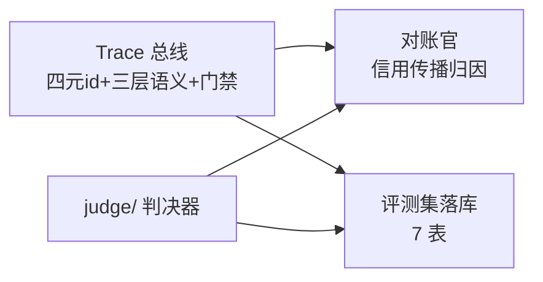

# P0 落地规格（Trace 总线 · 评测集落库 · 对账官）

> **PLAN-03 · P0 剩余三块的可落地规格**。把「一句话级设计」钉成「schema / 接口 / 门禁规则 / 验收判据」。
> 三块的权威设计分别在 [可观测平台设计](/observability.html)、[评测集设计](/eval-dataset.html)、[自进化设计](/self-evolution.html) 第 4 节与 [协议](/protocol.html)；本页是它们的**实现规格与当前落地状态**，是后续接线的唯一入口。

## 0. 范围与关系

P0 完成判据（[落地路线](/roadmap.html)）是「oracle 测试能识别正 alpha；独立日 ≥30；配对检验可用」。判决器 harness 已闭环（`judge/`），P0 还剩三块地基：

- **Trace 总线**（`trace/`）是其余两块的共同前置：span 是归因证据与落库记录的来源。
- **评测集落库**（`eval_dataset_v1.sql`）把判决器输出沉淀为可回放、可切片的样本。
- **对账官**（`reconcile/`）消费判决结果 + 溯源图，输出回滚信号。

三块均遵循「先写确定性代码，再包 agent」——本页只落确定性核心，LLM agent 壳后续再包。

## 1. Trace 总线（已实现 `trace/`）

### 1.1 Span 模型（`trace/model.py`）

- **`SpanType`**：8 类 span（`turn`/`llm`/`data`/`tool`/`retrieve`/`guard`/`judge`/`event`），与 [总架构](/overview.html) 的 span 类型表一致。
- **`Span`**（frozen 值对象）：`span_id` · `span_type` · `name` · `session_id` · `ts` · `attrs` · 可选 `decision_id`/`strategy_id`/`factor_id`/`parent_span_id`。
- **四元 id**（`trace/ids.py`）：`session_id`= `sesn_YYYYMMDD_<8位>`、`decision_id`= `dec_<日期>_<序号>`、`strategy_id`/`factor_id`= `<name>@<version>`。一条决策全链同串 id。

### 1.2 三层语义 + 前缀门禁（`trace/gate.py`）

| 层 | 前缀 | 内容 |
| --- | --- | --- |
| L1 通用 | `trace.*` | 会话/回合/模型/工具调用通用字段 |
| L2 交易域 | `trad.*` | 决策/策略/因子/对账专属语义 |
| L3 口径 | `a股.*` | 复权基准/单位/代码格式/涨跌停/板块 |

- **硬门禁（默认）**：span 属性键必须以下列三前缀之一开头，否则 `GateError` 拒绝——「未经严谨考证的数据不用于决策」的机械断言。
- **严格模式（`strict=True`）**：额外要求键在 `KNOWN_ATTRS` 注册表内（防拼写漂移）。

### 1.3 append-only 哈希链（`trace/bus.py`）

- `TraceBus.append(span)`：门禁校验 → 落一行 JSONL；每行 `hash = sha256(prev_hash + 规范化自身)`，首行 `prev_hash = 0*64`。
- `TraceBus.verify(path)`：逐行重算校验链完整性；篡改任意一行即失败。
- 复盘只能基于原始 trace；append-only，永不改写。

### 1.4 验收判据

| # | 判据 | 状态 |
| --- | --- | --- |
| T1 | 8 类 SpanType 全覆盖 | ✅ `tests/test_trace_gate.py` |
| T2 | 三层前缀放行 / 非法前缀拒绝 / strict 拒绝未注册键 | ✅ 同上 |
| T3 | 两 span 追加成链、篡改被检出、重启续链、非法 span 不落盘 | ✅ `tests/test_trace_bus.py` |
| T4 | 四元 id 格式与确定性 | ✅ `tests/test_trace_ids.py` |

> 当前 15 个单测全绿（`pytest tests/test_trace_*.py`）。**未做**：OTLP push sink、采集层订阅、span 表落库（见 §2 的 `decision_event.trace_id` 与后续接线）。

## 2. 评测集落库（已建 DDL `scripts/eval_dataset_v1.sql`）

### 2.1 七表（`eval_dataset_v1.sql`）

| 表 | 用途 | 写方 |
| --- | --- | --- |
| `caliber_meta` | 口径元数据（复用 `caliber_contract_v1.sql`） | 数据管家 |
| `decision_event` | 决策事件（信号触发 T 日，四元 id + `trace_id`） | 数据管家 |
| `regime_label` | regime 标签（决策时点打标，绑口径版本） | 数据管家 |
| `sample_basket` | 当日合并篮子 + 剔 beta 超额 | 数据管家 |
| `paired_control` | 同天随机等规模对照 | 回测判决官 |
| `verdict` | 判决结果（只读生产） | 回测判决官 |
| `price_snapshot` | 冻结前复权快照（保证 GT 可复现） | 数据管家 |

三条落库原则：**冻结快照保 GT 可复现**（前复权随除权漂移，必须冻结）、**分层可切片**（regime 打散成列）、**口径版本绑定**（`caliber_id` 外键）。

### 2.2 验收判据

| # | 判据 | 状态 |
| --- | --- | --- |
| E1 | 7 表 DDL 可执行、外键/索引齐备 | ✅ DDL 就绪（未在评测库实跑） |
| E2 | `verdict`/`paired_control` 由判决器输出回填 | ⏳ 接线未写（见 §4） |
| E3 | `regime_label` 覆盖候选维度 | ⏳ 仅 5 基础列；6.2.2 的 8 候选待任务 16 验证后 `ALTER TABLE ADD COLUMN` |

## 3. 对账官（已实现 `reconcile/` 确定性核心）

### 3.1 溯源图 + 信用传播（`reconcile/graph.py`）

- `ProvenanceEdge(src, dst)`：`src` 引用 `dst`（决策 → 因子 → 口径 / 知识卡 → 来源书 / skill → 知识卡）。
- `ProvenanceGraph.credit_propagate(root, blame, decay)`：从决策沿依赖边 BFS，`credit = blame × decay^距离`，多路径取最短距离。
- **图距离 ≠ 时间顺序**：距离 1 = 本轮检索引用，距离 2 = 直接祖先，距离 3 = 间接祖先。

### 3.2 对账结论 + 回滚信号（`reconcile/reconcile.py`）

`reconcile(decision_id, excess_net, tstat, graph)` 输出 `Reconciliation`：

| 判决 | 判据 | 动作 |
| --- | --- | --- |
| `rejected` | `tstat <= -2.0`（显著坏） | 信用传播 → 回滚信号（信用 ≥ 阈值的节点降序） |
| `accepted` | `tstat >= +2.0`（显著好） | 无 blame |
| `unknown` | 其余 / 缺失 | 证据不足，不下结论 |

> 阈值 `sig_t`/`decay`/`rollback_threshold` 均为可注入参数，默认 2.0 / 0.5 / 0.25。

### 3.3 验收判据

| # | 判据 | 状态 |
| --- | --- | --- |
| R1 | 信用按图距离衰减、最短路径优先 | ✅ `tests/test_reconcile.py` |
| R2 | rejected 产出 blame + 回滚；accepted/unknown 不产出 | ✅ 同上 |
| R3 | 阈值过滤回滚信号 | ✅ 同上 |
| R4 | 接线层：判决汇总 → `verdict` 行 + 对账结论（两者 verdict 一致） | ✅ `tests/test_reconcile_wire.py` |

> 当前 28 个单测全绿（`reconcile` 7 + `wire` 6 + `trace` 15）。**未做**：把 `judge.baseline/probe` 的 JSON 汇总转成 `JudgedSignal` 的上游转换、4 决策节点断言（因子失效/信号过期/出场太慢/仓位过头）的映射、回滚信号的落库。

## 4. 下一步（后续轮次）

1. ~~**接线 adapter**~~ → ✅ 已完成：`reconcile/wire.py`（`JudgedSignal`/`VerdictRow` + `wire()`）+ `reconcile/from_judge.py`（baseline/probe 报告 JSON → `JudgedSignal`，真实报告端到端验证通过）；**仅剩**：`verdict`/`paired_control` 回填评测库（需 DB 空闲）。
2. **span 落库**：`TraceBus` 的 span → `decision_event.trace_id` 与采集层订阅（OTLP push sink）。（仍待做）
3. ~~**regime 打标代码**~~ → ✅ 已完成：`regime/tagging.py`（5 维分桶）+ `regime/query.py`（DB 适配：涨停家数/beta/换手率分位/拥挤度分位，实库验证）+ `regime/run.py`（跑数脚本）。
4. ~~**任务 16**~~ → 🟡 6/15 已实证：涨停家数/beta/市场宽度/换手率/拥挤度/大盘闸门（见 eval-dataset 6.2.3）；剩余 9 项需 LLM 或较大新增计算。
5. **数据管家 agent 壳**：~~把 `taobao_sync.py` 包成可运行 agent~~ → 🟡 契约层已完成：`custodian/contract.py`（`SYNC_TOOL` 契约）+ `custodian/sync_tool.py`（`run_sync` 幂等键 + 结构化结果）+ 6 单测（含契约↔真实 `sync()` 签名漂移守卫）。**剩余**：taobao_sync 补 `--help`/argparse、能力注册表接入、系统提示词文件化。
