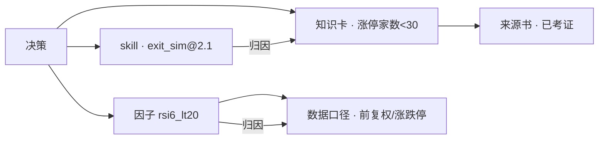

# 自进化设计（借鉴 MemRL）

> 把「自进化」方法论落到你的交易系统。核心一句话：**判决器（大脑）冻结，两个可进化层——策略/因子（α）与过程配置（prompt/skill/协议）——都由裁决面的输出驱动；反馈必须可机器验证。**

## 进化链路：裁决面输出 → 归因 → 两类进化

自进化不是只进化「会话/过程」，而是被**裁决面三个 agent 的输出**驱动的：


- **策略进化（主循环）**：裁决面判定「因子失效 / 信号过期 / 出场太慢 / 仓位过头」→ 因子工坊（换因子集 / 改定义 / 调参数）+ 策略师（调权重 / 改出场）→ **回测判决官影子回放 + 配对检验**验证 → 晋级/回滚。归因靠**信用传播**——因子是「可验证的算子」，简单公式够用。
- **过程进化（辅循环）**：会话评估官用**评估器**（证据 / 边界 / 判定）评判「推理质量 / 工具效率 / 协议合规」→ 能力管家改 prompt/skill/协议 → **三重门控（增益/遗忘/安全）** → 发布/回滚。过程是开放的「复杂算子」，**不套公式，靠评估器 + LLM Judge**。
- **归因分析是枢纽**（由**对账官**负责结果归因、**会话评估官**负责过程评估，见任务清单第 7 项）：裁决面输出 → 归因/评估 → 决定「改哪一层」。

> **两条进化路线的分水岭 = 可验证性**：因子用信用传播（可验证）、过程用评估器（开放语义）——完整解释见 [评测与可观测](/eval-platform.html) 的分水岭。方法论源头：MemRL 落在算子开发（闭式奖励），AI NEX 评估器落在开放对话（语义判断）。

**因子工坊的动作空间**（模型实施时只从这里选，禁止笼统「改因子」）：

| 动作 | 对象 | 字段 / 约束 | 过拟合风险 |
| --- | --- | --- | --- |
| add_factor / remove_factor | 因子集合 | factor_id | 低 |
| edit_factor_definition | 因子定义 | 公式（表达 alpha 逻辑） | 低 |
| tune_factor_params | 因子参数 | window / threshold + 合法搜索区间 | 高（必须前视防护） |
| reweight_factors | 组合权重 | weights（归一化） | 中高 |

> 硬约束：① 禁止裸动作——每个动作必须附带归因证据 id（为什么动这一层）；② 禁止笼统说「改/调整因子」，先归因、再落到上述某一类动作并给出字段值。

## 核心映射（MemRL → 你的系统）

| MemRL 概念 | 你的系统落地 | 对应 PLAN-03 组件 |
| --- | --- | --- |
| 意图-经验-效用 三元组 | 决策资产的三元结构（见下） | 资产登记官 |
| 大脑-记忆双核解耦 | 判决器冻结、只进化过程资产 | 裁决面 + 资产登记官 |
| 效用驱动的经验检索 | 决策时按 regime 检索效用最高的历史经验，不改判决器代码 | 主控 / 策略师 |
| 经验溯源图（依赖边归因） | 对账沿「依赖边」做多步结构归因，而非时间顺序 | 对账官 |
| 快慢双环 + 三重门控 | 在线快环更新效用 / 离线慢环影子回放 + 增益/遗忘/安全门控 | 会话评估官 + 评测平台 |
| 发布门禁（退化预算收缩） | 新版本超额 ≥ 旧版本 − 回测偏差；每接受一次收缩退化预算 | 回测判决官 |
| 记忆使用闭环（4 步） | 先找像的 → 再挑值的 → 现场验证 → 更新价值 | 策略师 / 资产登记官 |
| 谨防 Reward Hacking | 奖励 = 可机器验证的真实结果 | 判决器铁律 |

## 一、意图-经验-效用：决策资产的记忆结构

你 PLAN-03 里的「资产登记官」现在只写「决策/理由/结果/教训」，把它升级成 MemRL 的三元组：

```
{
  "intent":     "strategy_gen | market_turn | risk_reduce | ...",   // 决策意图
  "experience": {                                                    // 经验 = 完整轨迹
    "decision_pack": {...},   // 决策包（信号/进场/出场/仓位）
    "grips":        [...],    // 抓手（因子 id / 口径 id / 知识卡 id）
    "bases":        [...],    // 依据
    "trace_id":     "..."     // 四元 id 贯穿
  },
  "utility": {                                                       // 效用 = 判决器输出
    "regime":   ["涨停家数<30", "大盘beta高", ...],   // regime 标签
    "excess":   -0.42,       // 独立日超额（剔 beta）
    "tstat":    -5.16,       // 配对 t
    "win_rate": 0.34,        // 分层胜率
    "verdict":  "rejected"   // 判决结论（可追溯）
  },
  "provenance": ["factor:rsi6_lt20", "calib:v1", "skill:exit_sim@2.1", "prompt:strategist@7"]
}
```

::: tip 关键
**效用不是模型自评，而是判决器用真实结果算出来的**（独立日超额 / 剔 beta / 配对 t）。这才让「记忆不是玄学」——每条经验为什么被强化、为什么被降权，都可追溯。
:::

## 二、冻结层 vs 两个可进化层

| 层 | 内容 | 规则 |
| --- | --- | --- |
| 冻结（大脑） | 判决器 harness + 数据口径契约 + 回测引擎（确定性代码） | 参数/逻辑冻结，永不被"进化"改动 |
| 可进化 A（策略/因子） | 因子字典、策略 proposal、出场/仓位规则 | 经回测判决官影子回放验证后晋级 |
| 可进化 B（过程配置） | prompt/skill/协议版本、过程资产库 | 经三重门控发布，未通过回滚 |

这把你「判决器物理隔离」再推进一步：**隔离的不只是进程，还有「进化对象」**——进化只发生在两个可进化层（策略/因子 + 过程配置），绝不发生在判决器代码上。否则"进化"会污染判决器，重蹈"测试全过但决策没用"。

## 三、效用驱动的经验检索：改检索，不改决策逻辑

借鉴「用记忆检索替代重训」的**思想**，落到股票场景：策略师/主控决策时不改判决器、不重训模型，而是按当前 regime **检索历史上表现最好的经验**作参考与反例。

三条落地原则（不搬 RL 公式，只留思想）：

1. **按 regime 检索** — 决策时先看当前市场状态（涨停家数、大盘 beta、拥挤度），只检索「同 regime 下」的历史经验，避免跨 regime 错配。
2. **按真实结果排序** — 经验的「效用」不是模型自评，而是判决器用真实 T+N 超额（剔 beta）回填；检索时按效用从高到低取 Top-k。
3. **用结果回填效用** — 每次对账后，用真实结果更新这条经验在当前 regime 下的效用分，让下次检索更准。

**记忆使用闭环（4 步）：**

```
① 先找像的   语义召回：按 regime + 意图召回候选经验
② 再挑值的   效用重排：按效用分排序，取 Top-k
③ 现场验证   影子回放 / 实盘验证：这条经验在当前场景是否有效
④ 更新价值   用真实结果回填效用，让下次检索更准
```

- **regime** = 当前决策场景（涨停家数 / 大盘 beta / 拥挤度 / 换手率 + 意图）
- **效用** = 该经验在当前 regime 下的历史真实表现（判决器回填，非模型自评）
- 价值：策略师不需要重训、不需要改判决器，只需要「检索到对的先例/反例」就能变聪明；且每一步都可追溯。

## 四、经验溯源图：因子/策略的多步结构归因（信用传播）

> **适用范围**：信用传播只用于**因子 / 策略 / 决策资产**（结果归因）——这些是「可验证的算子」，有闭式奖励（回测 → T+N 超额），简单公式够用。**过程（推理质量 / 工具效率 / 协议合规）不套这个公式**，交给下一节「评估器驱动的过程进化」。

你现在对账是「逐条复盘抓手/依据」——是**时间顺序**。信用传播指出：**时间顺序 ≠ 因果来源，归因应沿经验依赖结构传播。**

给每条决策资产建溯源边（谁引用了谁）：



- 对账发现"决策差"时，信用沿溯源边回传：是因子失效、口径错、还是 skill 过时？
- 三层来源：本轮检索（第 0 层）→ 直接祖先（第 1 层）→ 间接祖先（第 2 层），信用按「最短图距离」而非时间间隔衰减。
- 这样你能回答"这个因子为什么之前被强化、现在该降权"——复盘结论可追溯。

## 五、过程进化：评估器驱动 + 三重门控

过程（推理质量 / 工具效率 / 协议合规）是「复杂算子」——没有闭式奖励，简单公式驾驭不了，所以用**评估器**评判（评估器的三要素 / 多粒度 / 开发流程 / 验证三件套见 [评估器设计](/evaluator.html)，这里只保留进化层的闭环与门禁）：

**快慢双环**：

| 环 | 你的系统 | 目标 |
| --- | --- | --- |
| 在线快环 | 决策 → 实际结果 → 判决器 → 更新过程资产效用 | 承担跨 regime 表现、遗忘、100+ 轮稳定性的主考核 |
| 离线慢环 | 影子回放 → 配对检验 → 三重门控 → 发布/回滚 | 独立评价 prompt/skill/协议 版本，不与快环结果混算 |

**三重门控**（增益/遗忘/安全，是过程进化的「发布门禁」，判据来自评估器产出）：

| 门控 | 你的判据 |
| --- | --- |
| 增益 | 过程 badcase 率下降，且达到最小效应量 |
| 遗忘 | 问题回归集全过；已修复问题不复发；其他评估器不退化 |
| 安全 | A 股规则合规：无越权；无口径违规 |

只发布「被验证」的能力；未通过则回滚到上一版。

## 六、谨防 Reward Hacking：可信奖励是自进化的前提

这是整份分享对你的**最强提醒**，也直指你「测试通过不代表决策质量好」的痛点：

| 反模式（奖励作弊） | 你的对策（奖励可机器验证） |
| --- | --- |
| 用模型自评当奖励 | 用**实际成交 T+N 结果**当奖励 |
| 用过程指标（工具调用成功）当奖励 | 用**剔 beta 超额 + 配对 vs 随机对照**当奖励 |
| 用交易笔数虚增样本 | 以**日**为独立样本，n≥5 |
| 评估器自己"来回翻" | 用**标签 logprobs** 判评估稳定性，低置信升级 |
| 优化时偷看未来 | 影子回放严格按前视偏置防护（oracle 测试把关） |

::: warning 铁律
奖励定义错了，整个自进化会朝错误方向狂奔。所以判决器（可信奖励的来源）必须**优先于**任何自进化机制先立起来——这正是你 PLAN-03 里「P0 判决器先行」的另一层含义。
:::

## 七、自进化依赖可观测（反向链接）

自进化的每一次「进化动作」都必须有可观测的归因证据支撑：

- 归因证据来自 [可观测平台设计](/observability.html) 的指标归因（badcase 率按节点统计）+ 溯源图。
- 效用 Q 由判决器回填，判决器读的是 trace + 实际结果——都是可观测层的产物。
- 进化动作（因子 4 类动作 / 改 prompt-skill）必须带「归因证据 id」，证据 id 指向可观测层的一条具体归因。

一句话：**可观测建立事实，自进化依据事实改进；事实不可靠，改进就是赌博。**

## 与 PLAN-03 的衔接

本页把 PLAN-03 的「裁决面 / 资产登记官 / 自我进化闭环」具体化了三件事：

1. **资产登记官**：从「蒸馏教训」升级为「意图-经验-效用 + 溯源」结构化资产。
2. **裁决面输出驱动**：回测判决官 / 对账官 / 会话评估官的结果触发归因分析，作为两类进化（策略 / 过程）的共同驱动。
3. **自我进化铁律**：冻结判决器、进化两个可进化层（策略/因子 + 过程配置）、奖励可机器验证。
